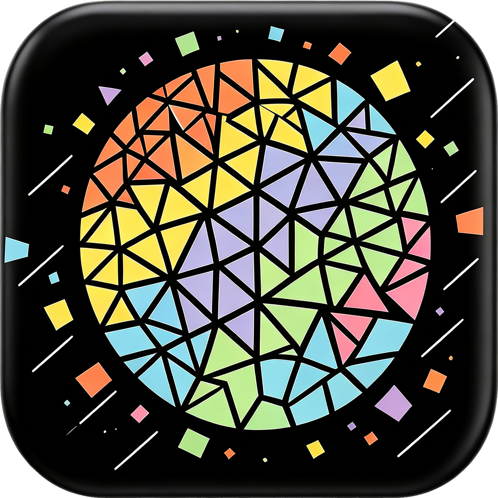
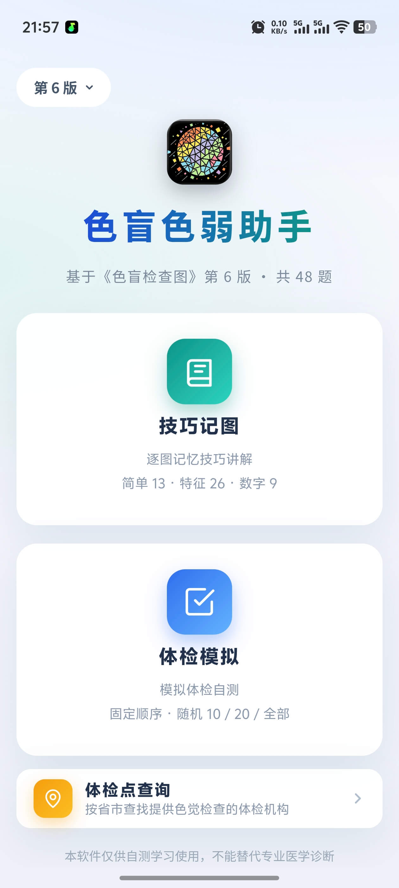
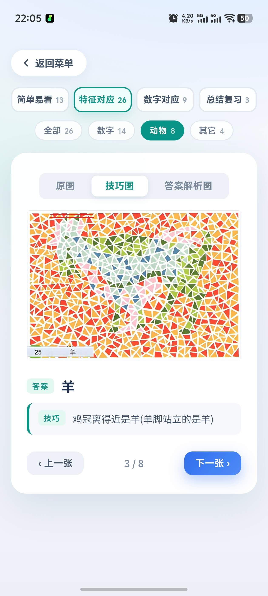
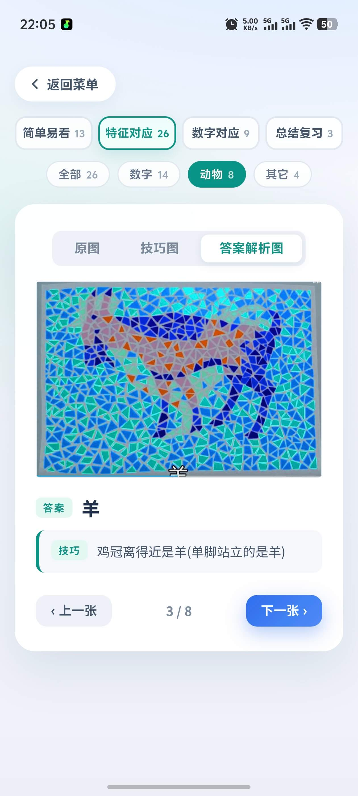
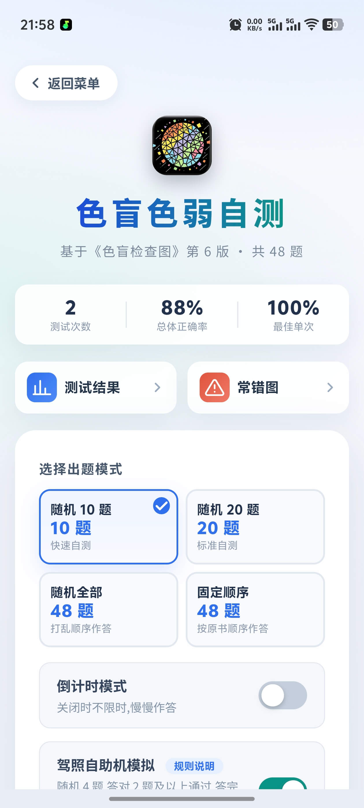
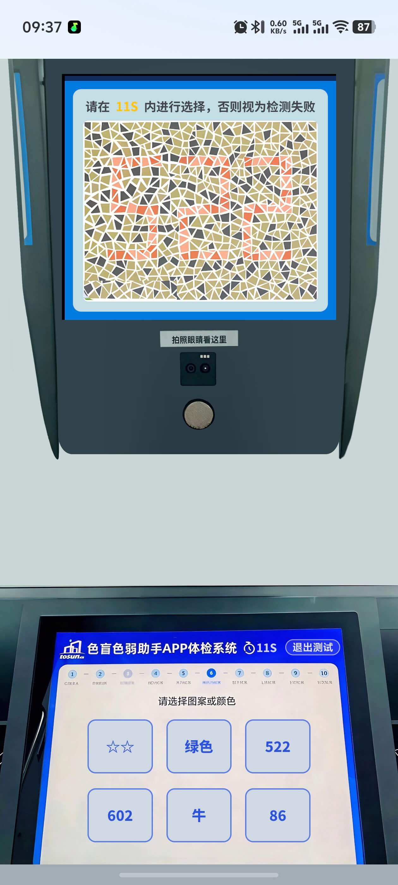
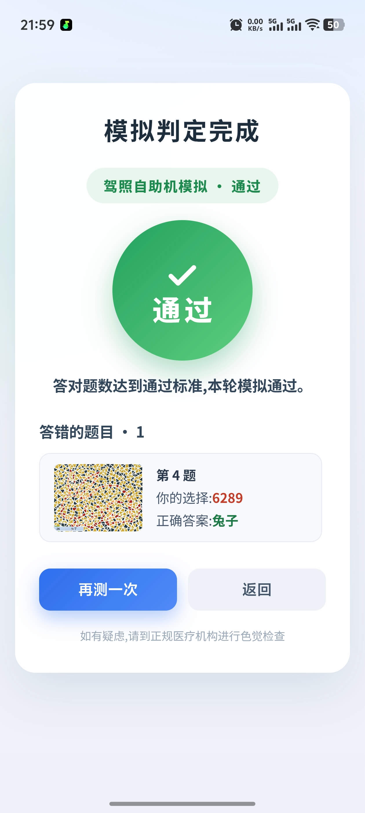
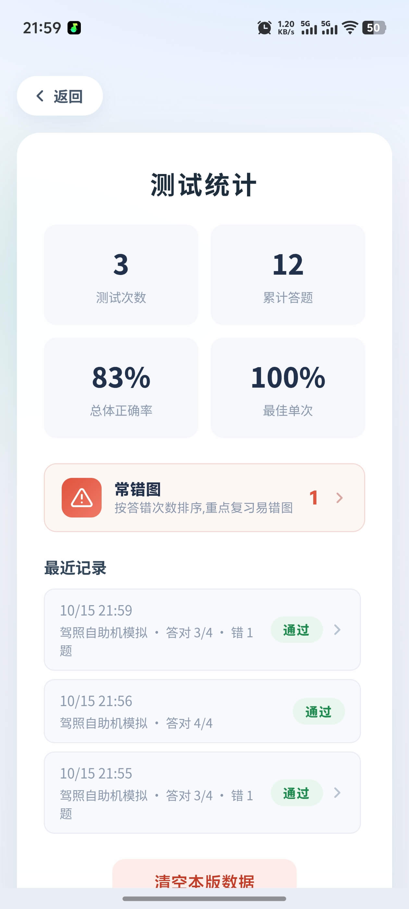
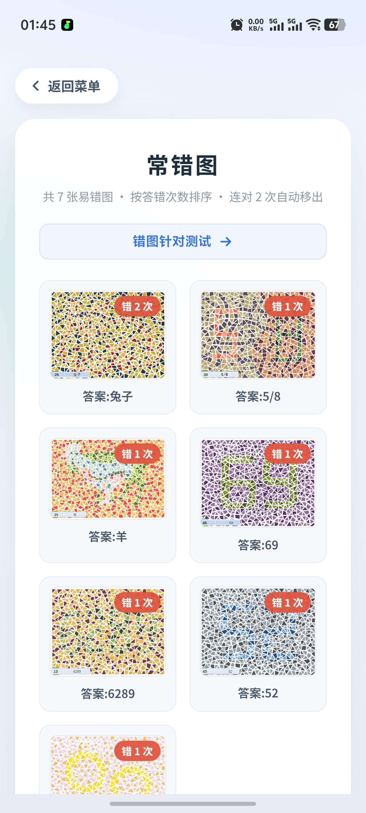
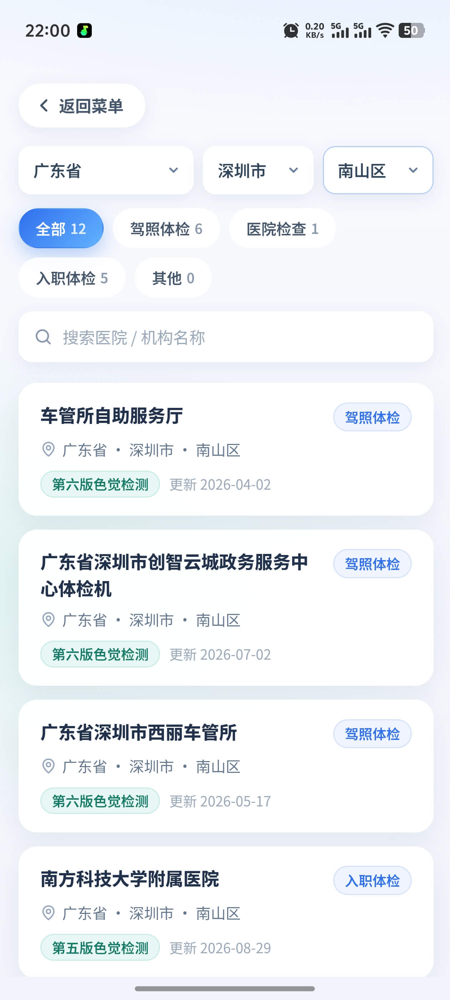

<div align="center">
<p></p>

<h1>色盲色弱助手</h1>

<p>
   <strong>Vue 3 + Vite 打造的多版本色盲色弱自测与记图助手</strong>
</p>

<p>
  <a href="https://semangseruozhushou-3qfb2wa.maozi.io/" target="_blank" rel="noopener noreferrer"></a>&nbsp;&nbsp;
</p>

<p>
  <sub>Made with ❤︎ by
    <a href="https://github.com/Ikarows">Ikarows</a>
  </sub>
</p>


</div>

<br>

一款基于俞自萍《色盲检查图》的多版本单页 Web 应用，内置**第六版**（48 图）与**第五版**（65 图）两套题库，首页一键切换。同时支持打包为 Android APP（Capacitor）和 Windows 桌面程序（Electron）。提供 **体检模拟**、**技巧记图**、**体检点查询** 三大模块，帮助用户自测色觉、备考驾考体检。

## 应用预览

<div align="center">
  &nbsp;
  &nbsp;
  
  <br><br>
  &nbsp;
  &nbsp;
  
  <br><br>
  &nbsp;
  &nbsp;
  
</div>

## 功能特性

### 多版本题库

- **双版本内置**：俞自萍《色盲检查图》第六版（48 图）与第五版（65 图），学习技巧逐图整理
- **一键切换**：首页左上角版本徽章弹出列表切换，带柔光胶囊过渡动画与内容错落入场
- **按版本隔离**：题目、学习内容、统计记录、常错图、错题针对测试全部跟随当前版本，互不混淆

### 技巧记图

按当前版本展示学习内容，卡片式浏览，每次随机排序：

- **第六版**：51 条，四分类——简单易看 13 / 特征对应 26（子分类：数字 14 / 动物 8 / 其它 4）/ 数字对应 9 / 总结复习 3
- **第五版**：65 条，按有无技巧图划分——特征对应 13 / 数字对应 11 / 简单易看 41
- **三视图切换**：原图 / 技巧图 / 答案解析图（有技巧图的默认展示技巧图，无技巧图的条目自动隐藏切换栏）
- **图片放大**：点击全屏查看，支持滚轮缩放、拖动平移、双击放大复位、移动端双指捏合，点击空白或 × 关闭

### 体检模拟

- **出题方式**：随机 10 题 / 随机 20 题 / 随机全部 / 固定顺序
- **驾照自助机模拟**（可选开关）：模拟驾照自助体检机规则——随机 4 题、每题强制 14 秒倒计时、最多错 2 题，答完统一判定「通过 / 未通过」；首轮未通过自动触发**复测**（再抽 4 张全新图，同样判定），两轮均未达标才结束
- **倒计时模式**（可选开关）：每题限时 14 秒，进度条递减，最后 5 秒变红闪烁；超时自动判错并展示正确答案；开关状态本地记忆
- **选项干扰**：按当前版本答案动态生成，每题 6 个选项 = 同类型干扰 + 跨类型干扰（数字题混入动物、图形等），防止"看类型蒙题"
- **答题反馈**：选择后立即判分，答错高亮正确答案并抖动提示
- **结果报告**：100 分制评分、等级评价、错题回顾（含超时未答标注）；驾照模拟模式显示「通过 / 未通过」徽章

### 体检点查询

- **全国数据**：收录 1000+ 家提供色觉检查的体检机构（驾考体检 / 医院体检 / 入职体检等场景）
- **级联筛选**：省 / 市 / 区三级联动 + 体检场景标签 + 关键词搜索
- **无限滚动**：结果列表分页加载，流畅浏览
- **免责提示**：数据仅供参考，检查项目与流程以当地体检机构实际为准

### 统计与错题本

- **统计总览**：测试次数、累计答题、总体正确率、最佳单次，首页速览条一键直达（随版本切换自动过滤）
- **历史记录**：每条记录显示 100 分制评分（按分数着色）、出题模式与答对情况，驾照模拟记录显示「通过 / 未通过」
- **错图回看**：有错图的记录可点击进入"测试详情"，对照查看该次答错的图（你的选择 / 正确答案，图片支持放大）
- **常错图排行**：汇总当前版本的错图，按答错次数降序排列，支持一键发起「错图针对测试」
- **数据持久化**：统计与错图明细保存在 localStorage，支持按版本一键清空（确认弹窗标注版本名）

## 技术栈

- **前端**：Vue 3（`<script setup>`）+ Vite 6
- **Android**：Capacitor 5，正式签名 release APK
- **桌面端**：Electron + electron-builder（Windows NSIS 安装包）

## 项目结构

```
color-vision-test/
├── index.html                 # 入口 HTML（引用 favicon.ico 网站图标）
├── vite.config.js             # Vite 配置
├── capacitor.config.json      # Capacitor 配置（appId / 应用名）
├── package.json               # 脚本与依赖（含 electron-builder 配置）
│
├── src/
│   ├── main.js                # Vue 应用入口（先加载全局样式再挂载）
│   ├── App.vue                # 纯装配层：页面路由 + composable 解构
│   ├── styles/
│   │   └── base.css           # 全局共享样式（screen/card/btn 系列等）
│   ├── composables/           # 状态与业务逻辑（模块级单例）
│   │   ├── useStage.js        #   页面状态机
│   │   ├── useEdition.js      #   多版本上下文（切换/localStorage 持久化）
│   │   ├── useQuiz.js         #   出题、答题流程、倒计时
│   │   ├── useQuizConfig.js   #   出题配置与驾照模拟开关
│   │   ├── useRecords.js      #   统计记录（按版本过滤/聚合）
│   │   ├── useStudy.js        #   学习条目、分类显隐
│   │   ├── useZoom.js         #   图片放大（手势/滚轮）
│   │   └── useHospitalSearch.js # 体检点查询（懒加载+筛选）
│   ├── components/
│   │   ├── screens/           # 页面组件（stage 状态机驱动）
│   │   │   ├── MenuScreen.vue        # 首页菜单：版本徽章切换、功能入口卡、统计速览
│   │   │   ├── StartScreen.vue       # 开始页：出题模式选择、倒计时/驾照模拟开关
│   │   │   ├── QuizScreen.vue        # 答题页：等比缩放一屏显示、选项判分、复测确认层
│   │   │   ├── ResultScreen.vue      # 结果页：评分圈（驾照模拟为通过/未通过大圆）、错题回顾
│   │   │   ├── StudyScreen.vue       # 技巧记图：分类/子分类 tab、三视图切换
│   │   │   ├── HistoryScreen.vue     # 历史记录列表：评分徽章、按版本清空
│   │   │   ├── RecordDetailScreen.vue# 测试详情：单次记录的错图逐题回看
│   │   │   ├── WrongBook.vue         # 错题本：常错图排行、发起错图针对测试
│   │   │   └── HospitalsScreen.vue   # 体检点查询：省市区级联、场景标签、无限滚动
│   │   ├── ZoomOverlay.vue    # 图片放大层
│   │   ├── AgreementDialog.vue# 用户协议弹窗
│   │   └── DrivingHelpDialog.vue # 驾照模拟规则说明弹窗
│   └── data/
│       ├── editions/          # 版本数据包（v6.js / v5.js + index.js 注册表）
│       ├── questions.js       # 出题引擎（按版本答案动态生成干扰选项）
│       └── stats.js           # 历史成绩读写（localStorage，按版本管理）
│
├── public/
│   ├── favicon.ico            # 网站图标（由 logo.png 生成的 16-256 多尺寸 ICO）
│   ├── logo.png               # 应用 logo 原图（1024×1024，三端图标源）
│   ├── plates/v5/ v6/         # 各版本检查图原图（jpeg）
│   ├── study/v5/ v6/          # 各版本学习图：
│   │   ├── q_image*.png       #   技巧图（带题号边框）
│   │   ├── image*_d*.png      #   答案解析图（标出目标图形）
│   │   └── review_p*.png      #   总结复习页
│   └── vision_data/           # 体检点数据（hospitals.json + regions.json，按需加载）
│
├── build/                     # 三端图标资源与生成脚本
│   ├── icon.png / icon.ico    #   Electron 打包图标（由 logo.png 生成）
│   └── make-logo-icon.ps1     #   图标生成脚本（网站 ICO + Electron + Android）
│
├── android/                   # Capacitor Android 工程（mipmap-* 启动图标由脚本生成）
│   └── app/src/main/res/values/strings.xml  # APP 显示名称「色盲色弱助手」
│
├── electron/                  # Electron 主进程（桌面端入口）
└── dist/                      # vite build 输出（构建生成）
```

## 快速开始

```bash
npm install       # 安装依赖
npm run dev       # 开发调试（默认 http://localhost:5173）
npm run build     # 构建生产版本到 dist/
npm run preview   # 本地预览构建产物
npm run app:build # 构建 Windows 桌面程序（输出到 release/）
```

> **更换应用图标**：替换 `public/logo.png` 后运行 `powershell -ExecutionPolicy Bypass -File build\make-logo-icon.ps1`，即可一键重新生成网站 favicon.ico、Electron 图标与 Android 全套启动图标。

## Android 打包（release APK）

1. 构建并同步 Web 资源：

   ```bash
   npm run build
   npx cap sync android
   ```

2. 编译签名 APK（需 JDK 17，本项目使用 Android Studio 自带 JBR）：

   ```bash
   cd android
   .\gradlew.bat assembleRelease
   ```

3. 产物位于 `android/app/build/outputs/apk/release/`，命名「色盲色弱助手 {版本号}.apk」。

> **签名说明**：签名信息配置在 `android/key.properties`（指向 `android/keystore/color-vision.jks`）。

## 数据文件说明

### 版本数据包（src/data/editions/）

每个版本一个独立数据包（如 `v6.js`、`v5.js`），在 `index.js` 注册即可接入：

```js
export const v6 = {
  id: 'v6',
  source: '《色盲检查图》',   // 图谱来源
  name: '俞自萍',
  edition: '第 6 版',
  dirs: { plates: 'plates/v6', study: 'study/v6' }, // 图片目录
  questions: [/* { image, answer, type } */],
  studyItems: [/* 学习条目 */],
}
```

新增版本只需：准备图片目录 + 新建数据包 + 注册，出题引擎、统计、学习页自动生效。

### 出题引擎（questions.js）

`buildOptions()` 按当前版本答案**动态派生**干扰项：每题 6 个选项 = 正确答案 + 同类干扰（优先当前版本，不足自动并入其它版本）+ 跨类干扰，全部去重随机排列，新增版本零维护。

### 学习条目（数据包内 studyItems）

```js
{
  image: 'q_image11.png',     // 技巧图（public/study/{版本}/ 下）
  answer: '268',              // 正确答案
  category: 'number',         // easy | number | feature | review
  sub: 'num',                 // 特征对应子分类: num | animal | other
  tip: '记忆技巧文案',
  details: ['image11_d1.png'],// 答案解析图（可选）
  noTipImg: true              // 无真技巧图时标记，学习页隐藏技巧图栏
}
```

学习模式的"原图"视图按 `q_imageN.png → plates/{版本}/imageN.jpeg` 规则自动映射。

## 免责声明

本项目仅供个人学习与自测参考，<b>请勿商用。</b> 不不构成医学诊断，色觉检查请以正规医疗机构的专业检查为准。
